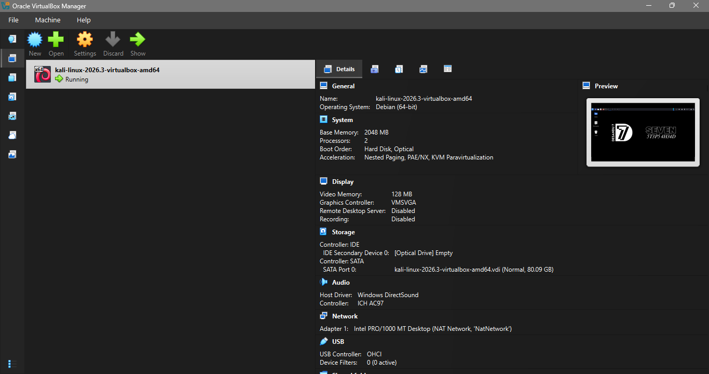
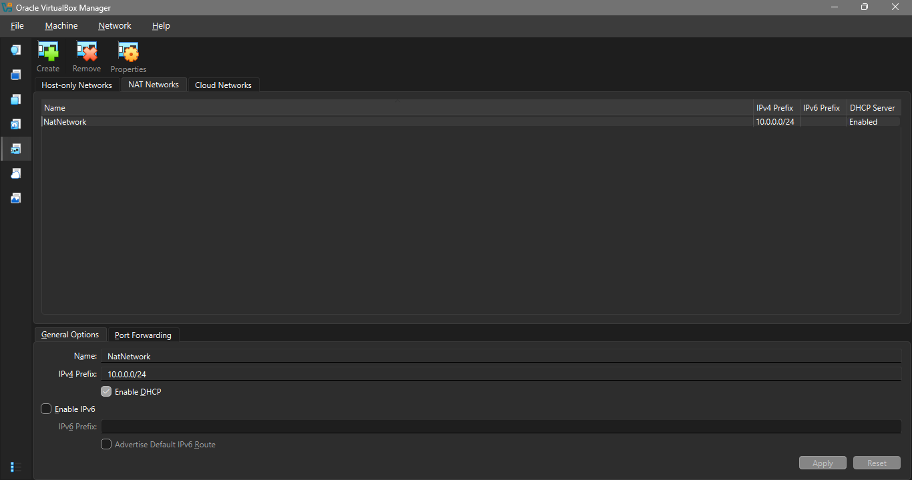
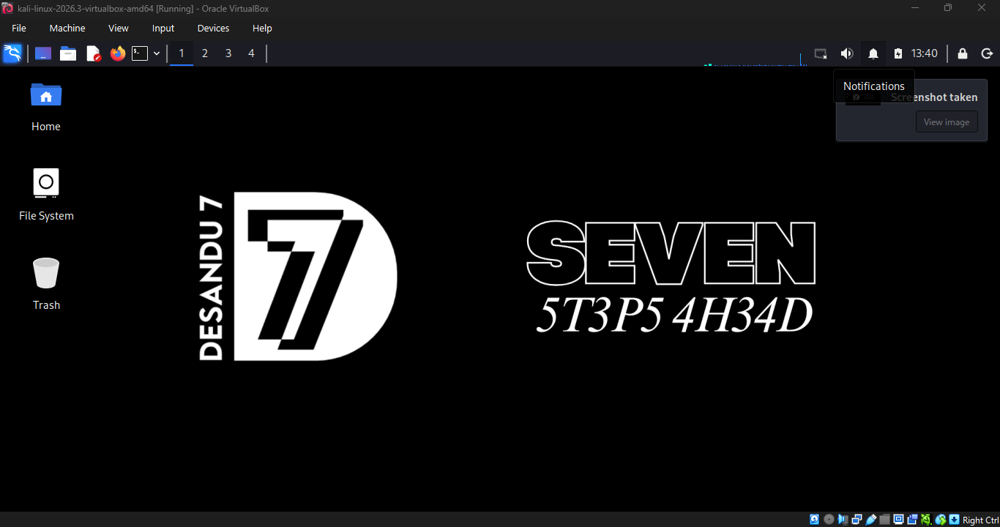
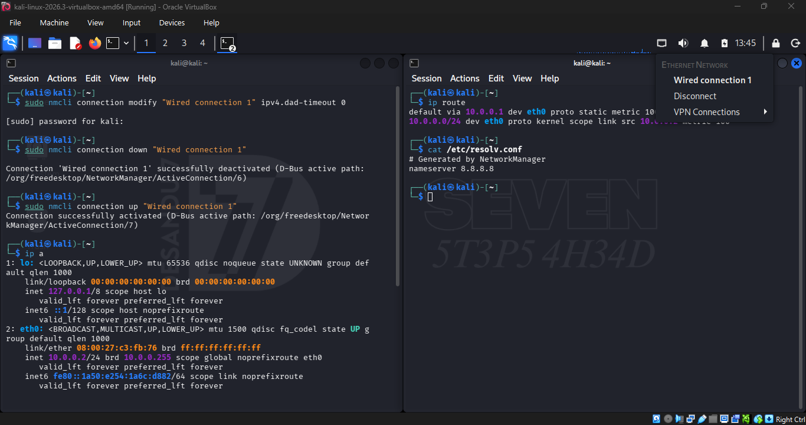
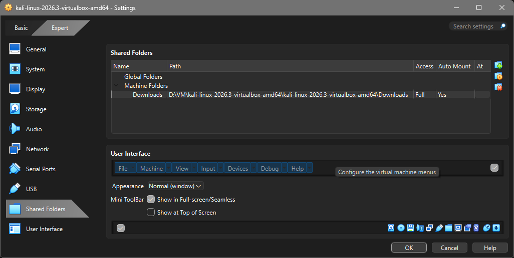
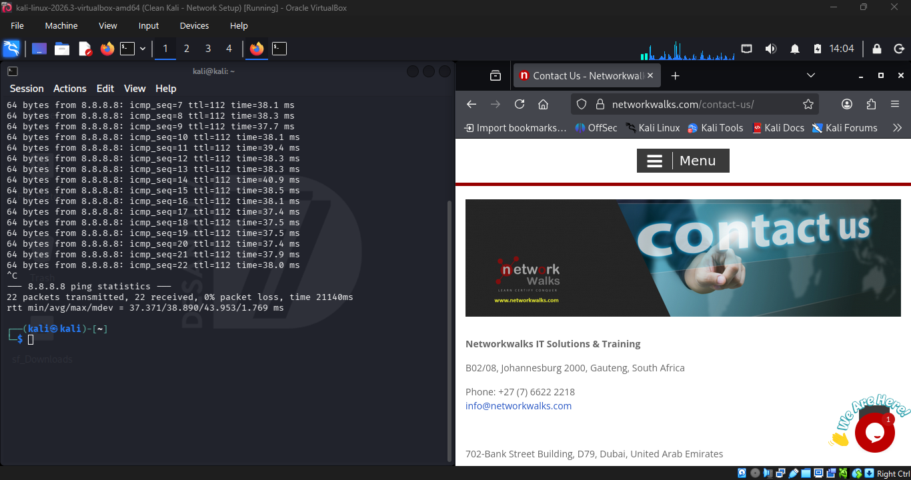
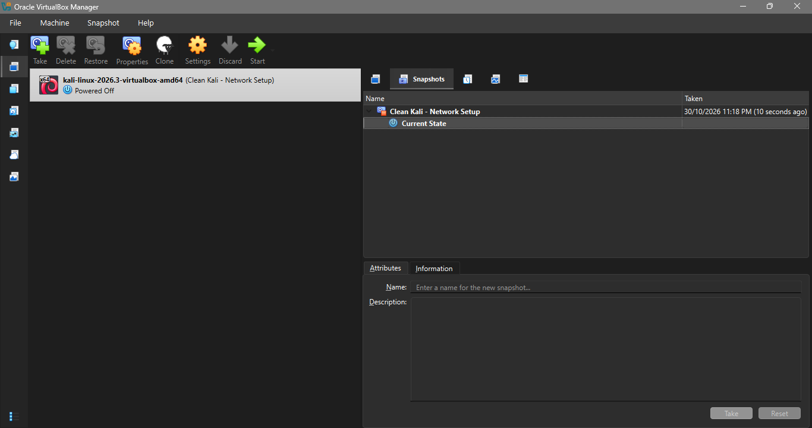

<div align="center">

# WK1-PM1: Kali Linux Virtual Machine Setup

### Networkwalks Cybersecurity Internship | Week 1


</div>

---

## 📌 Project Overview

This project covers the setup of a Kali Linux virtual machine using Oracle VirtualBox. The VM was configured with a NAT Network, shared-folder access and clipboard and drag-and-drop integration.

The main goal was to get a working Kali Linux environment, check its network configuration and confirm that it could reach the internet.

---

## 🎯 Objectives

- Install and configure Kali Linux in VirtualBox.
- Create and configure a VirtualBox NAT Network.
- Connect Kali Linux to the configured network.
- Check the VM's IP address, default gateway and DNS settings.
- Enable clipboard sharing and drag-and-drop.
- Configure a shared folder between the host and virtual machine.
- Verify internet connectivity.
- Create a snapshot of the configured VM.

---

## 🧪 Lab Environment

| Component | Configuration |
|---|---|
| Virtualization software | Oracle VirtualBox |
| Guest operating system | Kali Linux 2026.3 (64-bit) |
| VM memory | 2048 MB |
| Processors | 2 CPUs |
| Virtual disk | 80.09 GB |
| Network mode | NAT Network |
| NAT Network name | `NatNetwork` |
| Network range | `10.0.0.0/24` |
| Kali network interface | `eth0` |
| Kali IPv4 address | `10.0.0.2/24` |
| Default gateway | `10.0.0.1` |
| DNS server | `8.8.8.8` |
| Shared folder name | `Downloads` |

> Host-machine specifications and the exact VirtualBox version are not included because they were not part of the confirmed lab details.

---

## 🗺️ Lab Layout

```text
                 Host Machine
                      |
               Oracle VirtualBox
                      |
                 NatNetwork
                10.0.0.0/24
                      |
                Kali Linux VM
                 Interface: eth0
                      |
              10.0.0.2/24
                      |
              Default Gateway
                 10.0.0.1
                      |
                   Internet
```

---

## ⚙️ Setup and Configuration

### 1. Create the Kali Linux virtual machine

Created a new virtual machine in VirtualBox and selected the Kali Linux 64-bit operating system profile.

The VM was configured with 2 GB of RAM, 2 processors and an 80.09 GB virtual disk.



### 2. Configure the NAT Network

Created a VirtualBox NAT Network named `NatNetwork`.

The network was configured with the following settings:

- Network: `10.0.0.0/24`
- DHCP: Enabled



### 3. Start Kali Linux

Started the virtual machine and checked that Kali Linux loaded successfully.



### 4. Check the network configuration

Checked the network interface, IP address, default route and DNS configuration from the Kali terminal.

The VM used the following network details:

| Setting | Value |
|---|---|
| Interface | `eth0` |
| IPv4 address | `10.0.0.2/24` |
| Default gateway | `10.0.0.1` |
| DNS server | `8.8.8.8` |



### 5. Configure shared-folder access

Added a shared folder named `Downloads` in VirtualBox. The folder was configured with full access and auto-mount enabled.



### 6. Enable clipboard and drag-and-drop

Enabled clipboard sharing and drag-and-drop integration between the host machine and Kali Linux.

These settings make it easier to transfer text and files while working in the virtual machine.

### 7. Troubleshoot network connectivity

The network did not work immediately after the initial setup. I followed the network troubleshooting commands provided in the Networkwalks guide:

```bash
sudo nmcli connection modify "Wired connection 1" ipv4.dad-timeout 0
sudo nmcli connection down "Wired connection 1"
sudo nmcli connection up "Wired connection 1"
```

After running these commands, the network connection started working.

### 8. Verify internet connectivity

Tested the connection using:

```bash
ping 8.8.8.8
```

The test returned 22 packets transmitted, 22 received and 0% packet loss.



### 9. Create a virtual machine snapshot

Created a VirtualBox snapshot after completing the setup. This provides a restore point that can be used if the VM configuration needs to be recovered.



---

## ✅ Lab Verification

| Check | Result |
|---|---|
| Kali Linux starts successfully | Passed |
| NAT Network configured | Passed |
| Kali IP address checked | Passed |
| Default gateway checked | Passed |
| DNS configuration checked | Passed |
| Shared folder configured | Passed |
| Clipboard sharing enabled | Passed |
| Drag-and-drop enabled | Passed |
| Internet connectivity tested | Passed |
| VM snapshot created | Passed |

---

## 🛠️ Issues and Fixes

### Kali Linux had no network connection

**Issue:** The VM did not have working network connectivity immediately after setup.

**Fix:** Ran the three `nmcli` commands from the Networkwalks troubleshooting guide to set the IPv4 DAD timeout to `0`, then restarted the network connection.

**Result:** Internet connectivity was restored. A ping test to `8.8.8.8` completed with no packet loss.

---

## 📚 What I Learned

During this task, I got practical experience with:

- Creating and configuring a virtual machine in VirtualBox.
- Setting up a NAT Network and understanding its network range.
- Checking Linux network interfaces and IP configuration.
- Identifying the default gateway and DNS server.
- Troubleshooting a network connection using `nmcli`.
- Testing connectivity with `ping`.
- Configuring shared folders and VM integration features.
- Creating snapshots before making further changes to a virtual machine.

---

## 🔐 Security and Responsible Use

Kali Linux is a security testing distribution. Any tools used in this environment should only be tested on systems that I own or have explicit permission to assess. This lab was set up for learning and internship practice.

---

## 🧰 Tools and Resources

- [Oracle VirtualBox](https://www.virtualbox.org/)
- [Kali Linux](https://www.kali.org/)
- [NetworkManager `nmcli` documentation](https://networkmanager.dev/docs/api/latest/nmcli.html)

---

## 👨‍💻 Author

**Desandu Hettiarachchi**

Cybersecurity Undergraduate  
Networkwalks Cybersecurity Internship

LinkedIn: [https://www.linkedin.com/in/desanduthettiarachchi/](https://www.linkedin.com/in/desanduthettiarachchi/)

---

## 📄 Project Information

| Field | Details |
|---|---|
| Project | WK1-PM1 |
| Week | Week 1 |
| Program | Networkwalks Cybersecurity Internship |
| Topic | Kali Linux Virtual Machine Setup |
| Status | Completed |

---

<div align="center">

**Networkwalks Cybersecurity Internship | Week 1**

</div>
